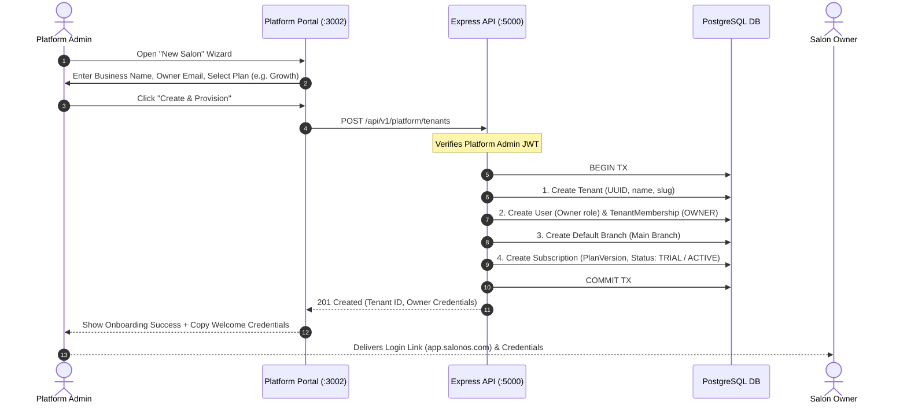
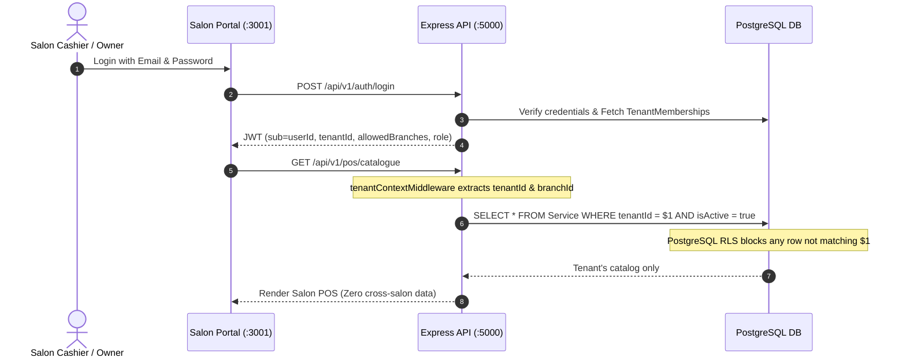
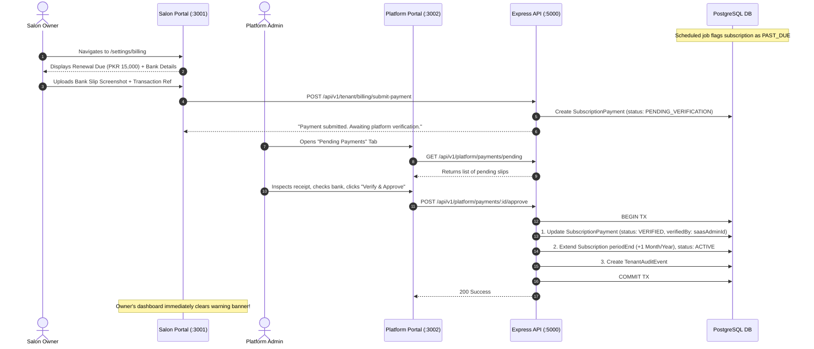
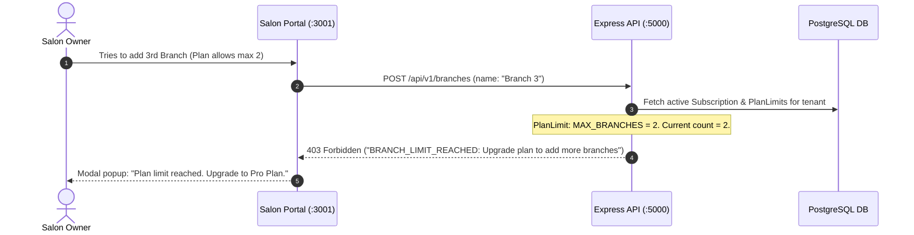

# SalonSys — Multi-Tenant SaaS Conversion PRD & Agent Roadmap
**Version:** 2.0 (Dual-Portal Architecture Release)  
**Date:** 30 October 2026  
**Language:** Roman Urdu + English  
**Architecture Pattern:** Dual Independent Frontends (SaaS Master Admin + Salon Client App) + Unified Express/Prisma Backend + Shared PostgreSQL with Row-Level Security (RLS).

---

## 1. Purpose & Core Vision
Existing working multi-branch salon software (**SalonOS / Meerab Salon Management System**) ko ek scalable, commercial **Multi-Tenant SaaS** platform mein convert karna hai.

### Fundamental Architectural Pillars:
1. **Option 2 Architecture (Decoupled Frontends):**
   * **Portal 1: Platform Master Admin Portal (`platform-portal`):** Completely independent, secure administrative frontend app for the SaaS Platform Owner/Team. Yahan se clients onboard honge, subscription plans manage honge, payment slips verify hongi aur system-wide health monitor hogi.
   * **Portal 2: Salon Operations App (`frontend`):** Existing luxury frosted glassmorphism application for salon owners, managers, cashiers, and stylists. Zero platform administration code or pricing internals are leaked into this frontend bundle.
   * **Unified Backend API Engine (`backend`):** Single resilient Node.js/Express service serving both portals with clear role and namespace boundaries (`/api/v1/platform/*` vs tenant-scoped operational endpoints).
   * **PostgreSQL Database with Defense-in-Depth:** Shared schema with explicit `tenantId` on all business records + PostgreSQL Row-Level Security (RLS).
2. **Business Continuity (Zero Breakage):**
   * Existing POS, Bridal/Groom advance commitment ledgers, appointment scheduling, staff compensation, tip pooling, cash drawers (custody), and inventory batching 100% preserve rahenge.
3. **Real-world Pakistan SaaS Commercials:**
   * Built for frictionless local adoption: Manual payment verification (Bank Transfer / JazzCash / EasyPaisa slips) with instant 1-click platform admin approval, while keeping the door open for automated card gateways (Stripe/PayFast) later.

---

## 2. System Topology & Dual-Portal Architecture

```
                  ┌─────────────────────────────────────────────────────────────┐
                  │                       PUBLIC INTERNET                       │
                  └──────────────────────────────┬──────────────────────────────┘
                                                 │
                                 ┌───────────────┴───────────────┐
                                 ▼                               ▼
                 ┌───────────────────────────────┐ ┌───────────────────────────────┐
                 │  PORTAL 1: PLATFORM ADMIN     │ │    PORTAL 2: SALON CLIENT     │
                 │   (admin.salonos.com / :3002) │ │    (app.salonos.com / :3001)  │
                 ├───────────────────────────────┤ ├───────────────────────────────┤
                 │ • Client Onboarding & Entry   │ │ • Luxury POS & Appointments   │
                 │ • Plans, Limits & Pricing     │ │ • Bridal Bookings & Cash Drawers│
                 │ • Manual Payment Verification │ │ • Staff, Attendance & Payroll │
                 │ • Tenant Suspension / Health  │ │ • Tenant Billing & Slips View │
                 │ • Audited Impersonation / Help│ │ • Multi-Branch Switcher       │
                 └───────────────┬───────────────┘ └───────────────┬───────────────┘
                                 │                                 │
                 Bearer Token    │                                 │ Bearer Token
                 (PLATFORM_ADMIN)│                                 │ (TENANT_OWNER/STAFF)
                                 ▼                                 ▼
                 ┌─────────────────────────────────────────────────────────────────┐
                 │             UNIFIED EXPRESS BACKEND API (:5000)                 │
                 ├────────────────────────────────┬────────────────────────────────┤
                 │  /api/v1/platform/*            │  /api/v1/tenant/* & Core APIs  │
                 │  • platformAuthMiddleware      │  • tenantContextMiddleware     │
                 │  • Platform Super Admin Guard  │  • Tenant & Branch Scoper      │
                 │  • Plan & Tenant Controllers   │  • Feature & Limit Evaluators  │
                 └────────────────────────────────┴────────────────────────────────┘
                                                  │
                                                  ▼
                 ┌─────────────────────────────────────────────────────────────────┐
                 │                POSTGRESQL 18 DATABASE ENGINE                    │
                 ├────────────────────────────────┬────────────────────────────────┤
                 │  PLATFORM SCHEMA TABLES:       │  TENANT ISOLATED TABLES:       │
                 │  • Tenant, TenantMembership    │  • Branch, User, Staff         │
                 │  • Plan, PlanVersion           │  • Invoice, InvoicePayment     │
                 │  • Subscription, BillingInvoice│  • Booking, BookingPayment     │
                 │  • SubscriptionPayment, Audit  │  • CashDrawer, InventoryBatch  │
                 │                                │  • Row-Level Security (RLS)    │
                 └────────────────────────────────┴────────────────────────────────┘
```

---

## 3. Core Distinction: Hierarchy & Access Boundaries

Hierarchy:  
**Platform Owner → Tenant (Salon Business) → Branch → Staff / Operational Records**

| Hierarchy Level | Example | Ownership Scope & Visibility |
| :--- | :--- | :--- |
| **Platform** | SaaS Company (You) | Tamam salons, subscriptions, platform billing, global audits. |
| **Tenant** | "Meerab Salon", "Ensemble" | Ek independent company. Shared catalog, clients, payment accounts, staff list. |
| **Branch** | "Gulberg Branch", "DHA Branch" | Single location physical transactions, POS, cash drawers, attendance. |
| **Staff / Cashier** | "Sara Stylist", "Ali Cashier" | Assigned branch, specific shift cash drawer, personal commissions. |

---

## 4. Portals Specification & Feature Breakdown

### 4.1 Portal 1: SaaS Master Admin Portal (`platform-portal`)
* **Technology:** Dedicated React 19 + TypeScript + Vite + Tailwind CSS app (runs on port `3002` in dev, `admin.salonos.com` in prod).
* **Target Audience:** Platform Super Admin, SaaS Operations Team, Support Agents.
* **Core Modules:**
  1. **Tenant Management Console:**
     * Register new salon company (Name, legal entity, primary owner email/phone, currency, timezone).
     * Provision initial owner account with temporary credentials or welcome activation link.
     * Tenant list with search, active filters, lifecycle status (`TRIAL`, `ACTIVE`, `PAST_DUE`, `SUSPENDED`).
     * Direct toggle: Suspend tenant (locks operational writes instantly).
  2. **Plan & Pricing Engine:**
     * Create & publish `Plan` and immutable `PlanVersion` (e.g. Starter, Growth, Enterprise).
     * Set limits: Max Branches allowed, Max Staff allowed, Max Devices allowed.
     * Set feature toggles: Biometrics Attendance, Advanced Payroll & Commissions, Custom SMS/WhatsApp, Multi-Drawer Custody.
     * Define billing cycle: Monthly, Quarterly, Annual with PKR/USD pricing.
  3. **Manual Payment Verification Center:**
     * Real-time inbox of pending renewal payment slips uploaded by salon owners.
     * Verification dialog: Inspect proof slip, verify bank reference code, transaction amount, receiving bank account.
     * Actions: **Approve & Activate** (advances subscription period immediately), **Reject with Reason**, or **Credit Adjustment**.
  4. **Support & Audited Impersonation:**
     * Time-bound, audited read-only or debug access to assist a salon client.
     * Har support login ka audit log banta hai (`actorId`, `tenantId`, `reason`, `timestamp`).
  5. **Platform Analytics:**
     * Active MRR (Monthly Recurring Revenue), total active salons, expiring subscriptions in next 7 days, platform revenue ledger.

### 4.2 Portal 2: Salon Client Operations Portal (`frontend`)
* **Technology:** Existing React 19 + Tailwind v4 + Framer Motion app (runs on port `3001` in dev, `app.salonos.com` in prod).
* **Target Audience:** Salon Owners, Branch Managers, Cashiers, Stylists, Inventory Clerks.
* **Core Modules:**
  1. **All Existing Salon Modules (Preserved 100%):**
     * POS, Day Schedule Appointments, Bridal/Groom Event Bookings, Inventory Batches, Staff Attendance, Payroll Runs, Cash Drawers, Expense Ledger.
  2. **Tenant Scoping & Custom Branding:**
     * Top header displays Salon Name + active Branch Selector.
     * Switch branch seamlessly for authorized multi-branch users.
  3. **Owner Billing & Subscription Screen (`/settings/billing`):**
     * Visible only to `TENANT_OWNER`.
     * Shows current Plan, Renewal Date, and Quota meters (e.g., "Branches: 2/3 used", "Staff: 18/25 used").
     * Payment Instructions: SaaS Bank Account IBAN, JazzCash / EasyPaisa merchant details.
     * **Upload Slip:** Owner attaches screenshot/receipt, enters transaction ID, submits for renewal.
  4. **Subscription Banners & Soft/Hard Lock:**
     * **Grace Period Warning Banner:** "Your subscription expired on Oct 25. Grace period active until Oct 31. Please renew."
     * **Hard Lock Mode:** If past grace period, dashboard shows "Account Suspended — Contact Billing" modal with read-only access to historic data, blocking new invoices/bookings.

---

## 5. End-to-End Operational Flows

### Flow 1: Client Onboarding & Plan Assignment (Platform Admin Initiated)


---

### Flow 2: Salon Daily Login & Strict Cross-Tenant Isolation


---

### Flow 3: Subscription Expiry & Manual Payment Slip Verification


---

### Flow 4: Quota & Limit Enforcement


---

## 6. Logical Data Model Specification

### 6.1 Platform & SaaS Subscription Tables (New)

```prisma
// ═══════════════════════════════════════════════════════════════════
// PLATFORM LEVEL MODELS (SaaS Control Plane)
// ═══════════════════════════════════════════════════════════════════

enum TenantStatus {
  TRIAL
  ACTIVE
  PAST_DUE
  SUSPENDED
  CANCELLED
}

enum SubscriptionStatus {
  PENDING
  TRIALING
  ACTIVE
  PAST_DUE
  SUSPENDED
  CANCELLED
  EXPIRED
}

enum PaymentProofStatus {
  PENDING_VERIFICATION
  VERIFIED
  REJECTED
}

model Tenant {
  id               String       @id @default(uuid())
  name             String
  slug             String       @unique
  logoUrl          String?
  status           TenantStatus @default(TRIAL)
  currency         String       @default("PKR")
  timezone         String       @default("Asia/Karachi")
  contactEmail     String
  contactPhone     String
  gracePeriodDays  Int          @default(7)
  createdAt        DateTime     @default(now())
  updatedAt        DateTime     @updatedAt

  memberships      TenantMembership[]
  subscriptions    Subscription[]
  branches         Branch[]
  billingInvoices  BillingInvoice[]
  tenantAuditEvents TenantAuditEvent[]

  @@map("Tenant")
}

model TenantMembership {
  id        String   @id @default(uuid())
  tenantId  String
  userId    String
  role      String   // 'TENANT_OWNER' | 'TENANT_ADMIN' | 'STAFF'
  status    String   @default("ACTIVE")
  createdAt DateTime @default(now())
  updatedAt DateTime @updatedAt

  tenant    Tenant   @relation(fields: [tenantId], references: [id], onDelete: Cascade)
  user      User     @relation(fields: [userId], references: [id], onDelete: Cascade)

  @@unique([tenantId, userId])
  @@index([userId])
  @@map("TenantMembership")
}

model Plan {
  id          String        @id @default(uuid())
  code        String        @unique // 'STARTER', 'GROWTH', 'ENTERPRISE'
  name        String
  description String?
  isPublic    Boolean       @default(true)
  createdAt   DateTime      @default(now())
  updatedAt   DateTime      @updatedAt

  versions    PlanVersion[]

  @@map("Plan")
}

model PlanVersion {
  id             String         @id @default(uuid())
  planId         String
  versionNumber  Int            @default(1)
  currency       String         @default("PKR")
  monthlyPrice   Decimal        @db.Decimal(12, 2)
  annualPrice    Decimal        @db.Decimal(12, 2)
  maxBranches    Int            @default(1)
  maxStaff       Int            @default(10)
  maxDevices     Int            @default(1)
  hasBiometrics  Boolean        @default(false)
  hasPayroll     Boolean        @default(true)
  hasCustomSms   Boolean        @default(false)
  isActive       Boolean        @default(true)
  createdAt      DateTime       @default(now())

  plan           Plan           @relation(fields: [planId], references: [id])
  subscriptions  Subscription[]

  @@unique([planId, versionNumber])
  @@map("PlanVersion")
}

model Subscription {
  id             String             @id @default(uuid())
  tenantId       String
  planVersionId  String
  status         SubscriptionStatus @default(TRIALING)
  billingCycle   String             @default("MONTHLY") // 'MONTHLY' | 'ANNUAL'
  currentPeriodStart DateTime
  currentPeriodEnd   DateTime
  graceUntil         DateTime?
  autoRenew      Boolean            @default(true)
  createdAt      DateTime           @default(now())
  updatedAt      DateTime           @updatedAt

  tenant         Tenant             @relation(fields: [tenantId], references: [id])
  planVersion    PlanVersion        @relation(fields: [planVersionId], references: [id])
  payments       SubscriptionPayment[]

  @@index([tenantId])
  @@map("Subscription")
}

model SubscriptionPayment {
  id                 String             @id @default(uuid())
  tenantId           String
  subscriptionId     String
  amount             Decimal            @db.Decimal(12, 2)
  currency           String             @default("PKR")
  paymentMethod      String             // 'BANK_TRANSFER' | 'JAZZCASH' | 'EASYPAISA' | 'CARD'
  transactionRef     String
  slipAttachmentUrl  String?
  status             PaymentProofStatus @default(PENDING_VERIFICATION)
  verifiedByUserId   String?
  verifiedAt         DateTime?
  rejectionReason    String?
  createdAt          DateTime           @default(now())

  subscription       Subscription       @relation(fields: [subscriptionId], references: [id])

  @@index([tenantId])
  @@index([status])
  @@map("SubscriptionPayment")
}

model TenantAuditEvent {
  id         String   @id @default(uuid())
  tenantId   String
  actorId    String
  actorRole  String
  action     String
  entity     String
  details    Json?
  createdAt  DateTime @default(now())

  tenant     Tenant   @relation(fields: [tenantId], references: [id], onDelete: Cascade)

  @@index([tenantId])
  @@map("TenantAuditEvent")
}
```

### 6.2 Tenant Scoping on Existing Business Models
Existing tables will receive `tenantId` (initially nullable, backfilled with `TENANT_LEGACY`, then made `NOT NULL`):
* `Branch` (`tenantId`, `code` unique per tenant)
* `User` (`tenantId` via `TenantMembership`)
* `Client` (`tenantId`, composite unique `[tenantId, phone]`)
* `ServiceCategory`, `Service`, `Package` (`tenantId`)
* `Invoice`, `InvoicePayment`, `InvoiceRefund` (`tenantId`)
* `Booking`, `BookingItem`, `BookingPayment` (`tenantId`)
* `CashDrawer`, `DrawerMovement`, `AccountMovement` (`tenantId`)
* `InventoryItem`, `InventoryBatch`, `StockMovement`, `Supplier` (`tenantId`)
* `Staff`, `AttendanceRecord`, `PayrollRun`, `Payslip` (`tenantId`)

---

## 7. Migration Strategy: Expand → Backfill → Enforce

To guarantee zero downtime and 100% preservation of Meerab Salon's active records:

```
[ Step 1: Expand ]
Deploy schema with new tables (Tenant, Plan, Subscription) + NULLABLE tenantId on existing tables.

[ Step 2: Backfill ]
Run automated migration script:
1. Create default Tenant: "Meerab Salon Main" (UUID: 00000000-0000-0000-0000-000000000001).
2. Attach all existing branches (Branch 1, 2, 3) to this Tenant.
3. Update ALL existing rows: UPDATE "Invoice" SET "tenantId" = '00000000-...' WHERE "tenantId" IS NULL; (and same for all 73 models).
4. Assign existing Super Admin user as TENANT_OWNER in TenantMembership.
5. Provision a lifetime Enterprise plan subscription for Meerab Salon.

[ Step 3: Validate ]
Reconcile financial control totals before vs after backfill:
• Total Invoices count & revenue = Exact match
• Total Cash Drawer balance = Exact match
• Inventory batch counts = Exact match

[ Step 4: Enforce ]
Alter columns to NOT NULL and create composite constraints + enable PostgreSQL RLS.
```

---

## 8. Agent Task Roadmap (A0 to A10)

| Task | Module | Scope & Deliverables | Acceptance Criteria |
| :--- | :--- | :--- | :--- |
| **A0** | **Baseline Audit** | Inspect models, verify dependencies (`Node 24`, `Prisma 5.22`, `Postgres 18`), capture baseline financial totals. | ✅ Done (Environment verified & PRD aligned). |
| **A1** | **Tenant Schema & Migration** | Add `Tenant`, `Plan`, `Subscription` models; add nullable `tenantId` to existing models; create safe backfill script. | Staging backfill finishes with identical totals. |
| **A2** | **Auth Context & Scoper** | Update JWT token to carry `tenantId`; implement `tenantContextMiddleware` and composite branch validation. | Token without tenant rejected; cross-tenant access denied. |
| **A3** | **Scoped Data Layer** | Retrofit Prisma service queries with mandatory `{ where: { tenantId } }`; eliminate unscoped queries. | Negative test: Tenant A cannot fetch Tenant B records. |
| **A4** | **PostgreSQL RLS** | Add PostgreSQL Row-Level Security policies on all tenant tables using transaction-local context (`SET LOCAL app.current_tenant_id`). | Direct raw query with foreign tenant ID returns empty set. |
| **A5** | **Plan & Limit Engine** | Implement server-side check for branch quota, staff quota, and module feature flags. | Block 3rd branch creation if plan limit is 2. |
| **A6** | **Platform Backend APIs** | Build `/api/v1/platform/*` endpoints (create tenant, list plans, verify payments, suspend). | Platform endpoints require `PLATFORM_ADMIN` role. |
| **A7** | **Platform Portal Frontend** | Scaffold & build independent React app (`platform-portal`) with Onboarding, Plans, and Payment Verification screens. | Platform admin can onboard a tenant and view slips cleanly. |
| **A8** | **Salon Billing Screen** | Add `/settings/billing` page inside existing Salon app for owner to view subscription and upload payment slips. | Salon owner can submit receipt and view live plan meter. |
| **A9** | **Regression & Isolation Test** | Run automated accounting test suite: POS invoice, bridal advance, commission reversal, multi-tenant concurrency. | Zero financial regression; zero cross-tenant leak. |
| **A10**| **Deployment & Pilot Setup**| Production deployment runbook (VPS Nginx dual reverse-proxy, automated backup scripts, smoke tests). | Pilot salon onboarded successfully alongside legacy salon. |

---

## 9. Definition of Done (DoD)
1. Both frontends (`platform-portal` and `frontend`) run independently with decoupled builds and separate security boundaries.
2. An operator in the Platform Portal can register a new salon, pick a plan, and provide instant login access.
3. The Salon Client App operates normally with zero awareness of other tenants or platform pricing code.
4. Tenant owner can view subscription usage and upload manual payment slips.
5. Platform admin can approve slips to activate or extend subscriptions with 1 click.
6. All existing Meerab Salon branches, invoices, advances, staff, and cash drawer balances remain 100% accurate and intact.
